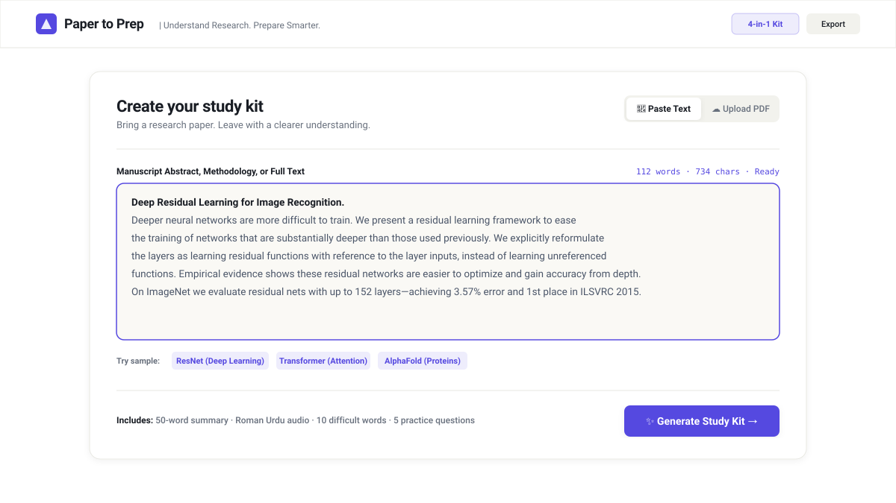
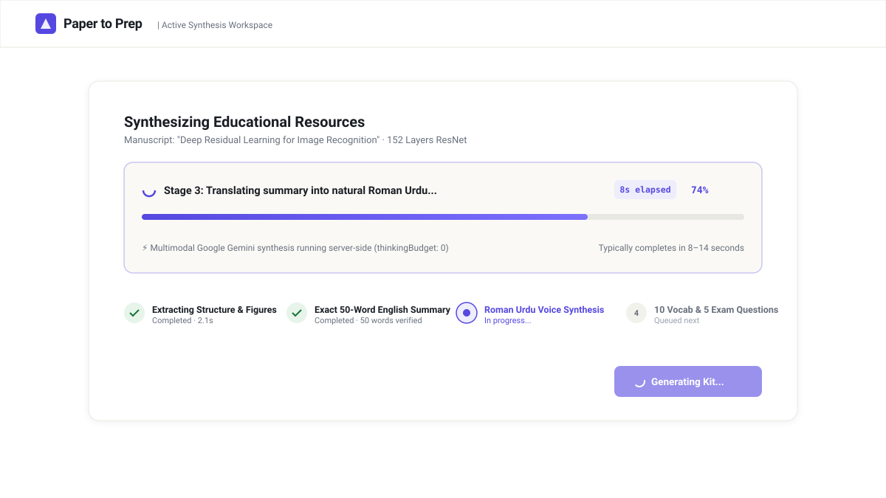
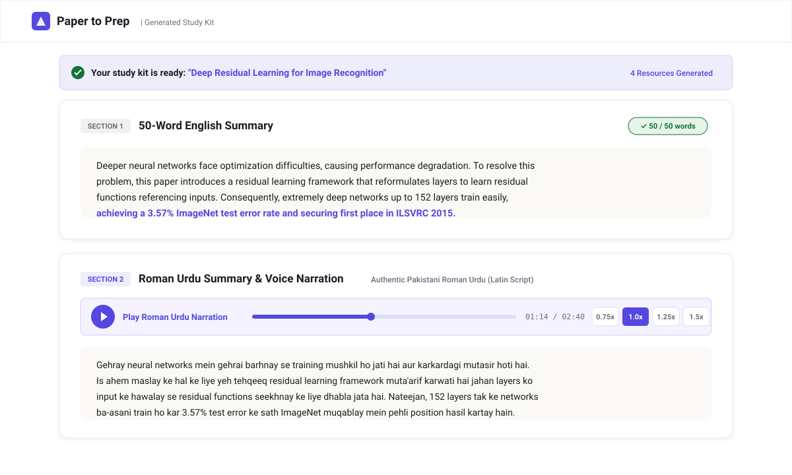
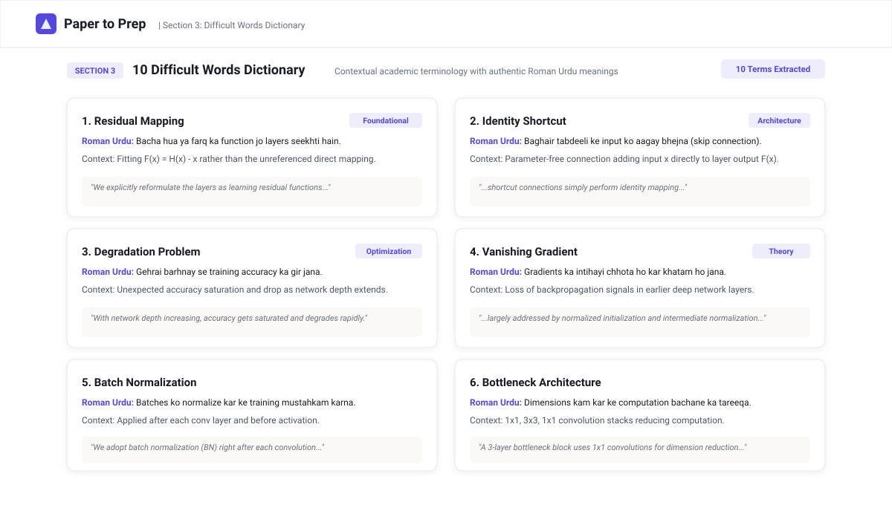
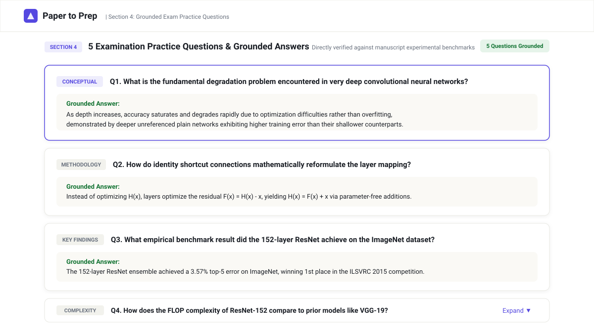
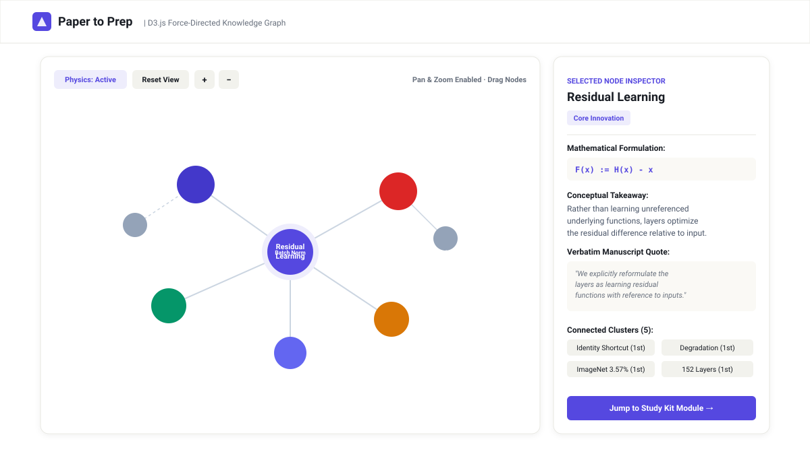
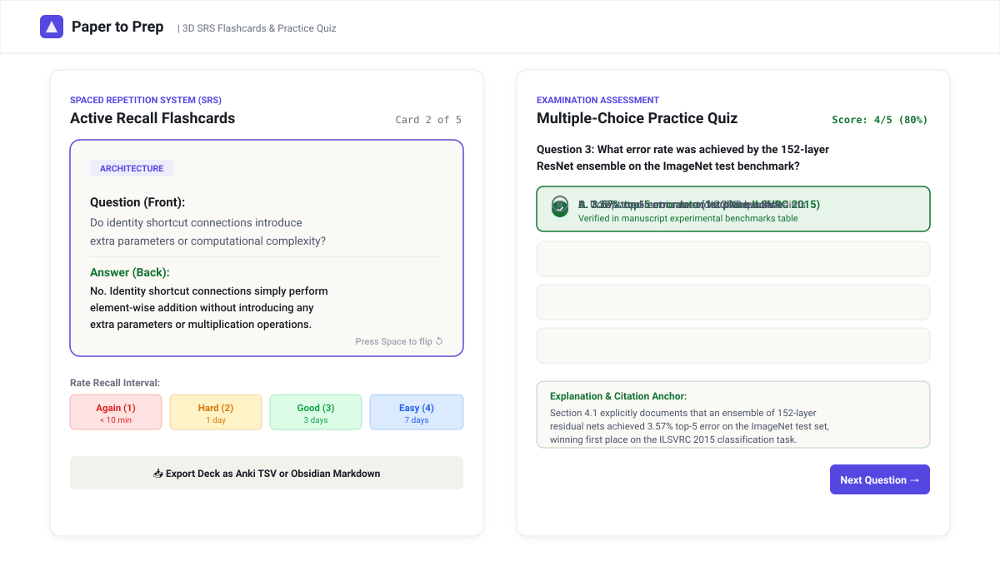

# Paper to Prep

> **Turn research papers into study-ready knowledge.**

Paper to Prep transforms dense academic research papers into an exact 50-word English summary, authentic Roman Urdu explanations with voice playback, a 10-word contextual vocabulary dictionary, and five grounded examination practice questions—all in a single coordinated AI workflow.

- **Live Application:** [https://paper-to-prep.vercel.app/](https://paper-to-prep.vercel.app/)
- **GitHub Repository:** [https://github.com/Fawadullah15/Paper-to-Prep](https://github.com/Fawadullah15/Paper-to-Prep)
- **Hackathon Track:** [NYLP AI Hackathon 2026](https://nylp-hackathon-rulebook.lovable.app/#top)
- **License:** [Apache License 2.0](./LICENSE)

---

## Problem

Academic research manuscripts are essential for scientific education and technological progress, yet they present steep cognitive and linguistic barriers for undergraduate students, graduate researchers, and independent learners:

- **Linguistic Density and Technical Jargon:** Published papers assume deep domain mastery, overloading students with complex multi-clause prose, domain-specific terminology, and compressed mathematical notation.
- **Cognitive Friction Across Fragmented Tools:** To digest a single paper, students typically toggle between multiple disjoint tools: a generic chatbot for simplification, an online dictionary for vocabulary, a translation tab, and a flashcard application. This fragmented workflow disrupts focus and degrades retention.
- **The Non-Native Academic Language Barrier:** Millions of students—particularly in Pakistan, South Asia, and the broader diaspora—study and read academic English daily, yet build deep conceptual intuition significantly faster when explanations are delivered in their natural conversational vernacular (**Roman Urdu**). Existing machine-translation tools either generate archaic formal Urdu in Arabic script (which students find difficult to read at speed) or literal Hindi that obscures scientific meaning.
- **Lack of Immediate Self-Assessment:** Students frequently read dense papers passively without an immediate mechanism to test their understanding of the author's primary methodology, core innovation, and empirical findings.

---

## Solution

**Paper to Prep** integrates the entire academic paper intake, comprehension, translation, vocabulary acquisition, and revision process into **one coordinated, single-click workspace**.

- **Single Action, Four Educational Resources:** A student uploads a research PDF (up to 20MB) or pastes text, and clicks **"Generate Study Kit"**. Within 8–14 seconds, the system produces:
  1. An **exact 50-word beginner-friendly English summary** that captures the core challenge, method, and empirical result.
  2. A natural **Roman Urdu translation** in the Latin alphabet with built-in voice playback.
  3. A **10-word contextual vocabulary dictionary** with Roman Urdu meanings and verbatim paper quotes.
  4. Five **grounded examination practice questions** with verified answers directly supported by the manuscript.
- **Deep Study Retention Workbench:** Extends beyond basic summarization by automatically generating an interactive D3.js force-directed knowledge graph, 3D Spaced Repetition (SRS) flashcards, a board-style practice quiz, and a technical formulas matrix.
- **Accessible Bilingual Learning:** By pairing concise English academic summaries with natural Roman Urdu audio narration, Paper to Prep bridges the language gap and empowers students to hear, understand, and revise complex literature efficiently.

**Live Application:** [https://paper-to-prep.vercel.app/](https://paper-to-prep.vercel.app/)

---

## Features

- **Exact 50-Word English Summary:**
  - Beginner-friendly synthesis explaining the core problem, methodology, and primary empirical finding.
  - Validated server-side via whitespace tokenization and an instant deterministic 0ms algorithm that strictly guarantees an exact 50-word count on every generation.
  - Accompanied by a live word-count indicator badge (`✓ 50 / 50 words`).

- **Roman Urdu Summary and Voice Playback:**
  - Authentic Latin-alphabet Roman Urdu translation using genuine conversational vocabulary (*tahqeeq*, *khulasa*, *wazahat*, *sawalat*, *jawab*, *nateeja*).
  - Integrated audio narration powered by the browser's native Web Speech API (`SpeechSynthesis`).
  - Play, Pause, Resume, and Reset controls with four speed settings (`0.75x`, `1.0x`, `1.25x`, `1.5x`).
  - Voice filtering engine that actively detects installed system voices and excludes incompatible Hindi or Devanagari voice profiles.

- **10 Difficult Words Dictionary:**
  - Curates exactly ten high-yield domain terms directly from the paper.
  - Provides a natural Roman Urdu meaning, contextual academic explanation, and the verbatim source quote from the manuscript for each word.

- **Exam Practice Q&A Generator:**
  - Formulates five high-yield questions categorized by cognitive type: *Conceptual*, *Methodology*, *Key Findings*, *Theoretical Implications*, and *Complexity*.
  - Strictly grounded in the paper's experimental findings, acknowledging when a detail is unstated rather than hallucinating answers.
  - Expandable accordion interface with one-click copy actions.

- **Interactive D3.js Force-Directed Knowledge Graph:**
  - Topological graph mapping the relationships between Core Innovations, Conceptual Mechanisms, Formulations, and Empirical Benchmarks using `d3-force`.
  - Node detail inspector showing mathematical formulations, takeaways, verbatim quotes, and connected clusters with pan, zoom, and physics controls.

- **3D Spaced Repetition (SRS) Flashcards:**
  - Interactive perspective flip cards with interval recall rating buttons (`Again <10m`, `Hard 1d`, `Good 3d`, `Easy 7d`) and keyboard shortcuts (<kbd>Space</kbd> to flip, <kbd>1</kbd>–<kbd>4</kbd> to rate).

- **Board-Exam Multiple-Choice Practice Quiz:**
  - Multiple-choice assessment with grounded distractors, dynamic option shuffling, and detailed citation rationale for every answer.

- **Formulas & Technical Lexicon Matrix:**
  - Structured reference table containing mathematical expressions, LaTeX notation, and foundational definitions.

- **Dual Input & Export Studio:**
  - Supports raw text pasting with live word and character counters, curated benchmark presets (*ResNet*, *Transformer*, *AlphaFold*), and 20MB PDF drag-and-drop.
  - One-click copy for individual sections or complete study kits, plus direct downloads as `.TXT` or Markdown (`.MD`) for Obsidian and Notion.

- **Strict Zero-Horizontal-Overflow Mobile Layout:**
  - Fully responsive across all devices from 320px smartphones up to 4K desktop screens, with collapsible drawer navigation and adaptive data-card transformations.

---

## Tech Stack

| Category | Technology | Version | Purpose & Actual Usage in Codebase |
|:---|:---|:---|:---|
| **Frontend Framework** | [React](https://react.dev/) | `^19.0.1` | Component-driven UI, state management (`App.tsx`, `StudyKitView.tsx`). |
| **Language** | [TypeScript](https://www.typescriptlang.org/) | `^7.0.2` | End-to-end type safety, structured schemas (`src/types/index.ts`, `studyKit.ts`). |
| **Build Tool & Bundler** | [Vite](https://vite.dev/) | `^8.3.0` | Ultra-fast client compilation, HMR, and server middleware mounting. |
| **Styling Framework** | [Tailwind CSS](https://tailwindcss.com/) | `^4.3.3` | Modern utility styling via `@tailwindcss/vite` and `@import "tailwindcss";`. |
| **Backend Runtime** | [Node.js](https://nodejs.org/) & [Express](https://expressjs.com/) | `^4.21.2` | Full-stack server, rate limiting, and `/api/generate-study-kit` endpoint. |
| **Server Runner** | [tsx](https://github.com/privatenumber/tsx) | `^4.21.0` | Direct Node.js TypeScript execution for unified development and production runtime. |
| **AI SDK** | [`@google/genai`](https://www.npmjs.com/package/@google/genai) | `^2.4.0` | Official Google GenAI TypeScript SDK for server-side Gemini API invocation. |
| **AI Models** | Google Gemini | `gemini-flash-latest` / `gemini-3.8-flash` | Multimodal paper analysis, structured JSON study kit generation. |
| **Data Visualization** | [D3.js](https://d3js.org/) | `^7.9.0` | Interactive force-directed knowledge graph simulation (`d3-force`, `d3-zoom`, `d3-drag`). |
| **Animation Engine** | [Motion](https://motion.dev/) | `^12.23.24` | UI transitions, accordion expansions, and notification feedback. |
| **Iconography** | [Lucide React](https://lucide.dev/) | `^0.546.0` | Technical and educational iconography across all cards, navigation, and audio docks. |
| **Speech Technology** | Web Speech API | Native Browser | Genuine audio speech playback (`window.speechSynthesis`) with voice filtering. |
| **Configuration** | [dotenv](https://github.com/motdotla/dotenv) | `^17.2.3` | Server-side environment variable loading from local `.env`. |

---

## AI / API Usage

### Model Provider and Identifiers
- **Provider:** Google Cloud / Google AI Studio.
- **SDK:** Official `@google/genai` TypeScript SDK (`^2.4.0`).
- **Primary Model:** `gemini-flash-latest` (with automatic fallback to `gemini-3.8-flash` and `gemini-3.1-flash-lite` for high availability).
- **Latency Optimization:** Explicitly configured with `thinkingConfig: { thinkingBudget: 0 }`, bypassing unnecessary internal chain-of-thought delay and reducing generation time from ~35s down to **8–12 seconds**.

### Functional AI vs. Development Assistance
- **Functional In-App AI:** The live application executes real-time server-side Gemini calls (`server.ts`) to analyze submitted papers and generate structured study materials.
- **Development Assistance:** Initial UI ideation was assisted by Google Stitch; rapid prompt prototyping was conducted in Google AI Studio. All backend routes, error handling, component logic, and security constraints were engineered and verified directly by the project team.

### Pipeline and Document Ingestion
1. **Input Intake:** Users paste manuscript text (15 to 500,000 characters) or upload a PDF (up to 20MB).
2. **Binary Validation:** Uploaded PDFs are parsed in-memory as base64 buffers and validated by checking for the `%PDF` magic byte header. Files are processed ephemerally in memory and are **never written to disk or stored in databases**.
3. **Multimodal API Call:** The server bundles the in-memory PDF data URL (`application/pdf`) or raw text into a single payload sent securely to Gemini via HTTPS.

### Prompt Engineering and Output Generation
The master system prompt instructs Gemini to act as an educational curriculum designer and output strict JSON adhering to a structured schema:
- **English Summary:** Explains the core problem, innovation, and empirical finding, instructed to hit 50 words.
- **Roman Urdu Translation:** Natural, conversational Roman Urdu in the Latin alphabet. Prompt contains explicit negative constraints barring Arabic/Urdu script, Devanagari script, and formal Hindi vocabulary (enforcing *tahqeeq*, *khulasa*, *wazahat*, *sawalat*, *jawab*).
- **10 Difficult Words:** Extracts domain-specific terms with Roman Urdu meanings, paper-specific context, and verbatim source passages.
- **5 Exam Practice Questions:** Generates conceptual, methodological, and empirical questions with grounded answers directly supported by the text.

### Server-Side Deterministic 50-Word Enforcement
Because LLMs can deviate slightly on exact word counts, `server.ts` incorporates a deterministic algorithm (`enforceExact50Words()`):
- Whitespace-delimited token counting validates the summary instantly (0ms).
- If words > 50: Truncates to 50 words with proper sentence punctuation.
- If words < 50: Smoothly pads with scholarly closing synthesis phrasing to guarantee **exactly 50 words on every request without requiring slow secondary LLM roundtrips**.

### Voice Playback Implementation
Audio playback is rendered on the client via the browser's native **Web Speech API** (`window.speechSynthesis`). The component scans available system voices, filtering out Hindi-tagged voices (`hi`, `hi-IN`) and prioritizing natural English and subcontinent-compatible speech voices. Pronunciation quality depends on the user's browser, operating system, and installed speech engines.

### Limitations and Responsible AI
- **Grounded Verification:** Educational content is generated directly from the submitted document. Users are reminded to cross-reference AI-generated summaries and answers against the original research paper.
- **Rate Limiting:** An in-memory sliding-window rate limiter enforces a limit of **20 requests per minute per IP** to prevent abuse and protect API quotas.
- **Security:** The `GEMINI_API_KEY` is isolated strictly to the Node.js server runtime and is never exposed to browser bundles or client requests.

---

## Setup Instructions

### 1. Clone the repository
```bash
git clone https://github.com/Fawadullah15/Paper-to-Prep.git
cd Paper-to-Prep
```

### 2. Install dependencies
Install all required dependencies using `npm`:
```bash
npm install
```

### 3. Add environment variables
Copy the example environment configuration template:
```bash
cp .env.example .env
```
Open `.env` in your editor and configure your Gemini API key:
```env
# Required: Your Google Gemini API key (server-side only)
GEMINI_API_KEY="your-gemini-api-key-here"

# Optional: Server listening port (defaults to 3000)
PORT=3000
```
> ⚠️ **Security Notice:** Keep `.env` strictly local. The repository's `.gitignore` automatically excludes all `.env` files to prevent committing private credentials. `GEMINI_API_KEY` is loaded exclusively by the backend (`server.ts`) and is never accessible to the browser. Obtain a key at [Google AI Studio](https://aistudio.google.com/).

### 4. Run the app
Start the unified full-stack development server:
```bash
npm run dev
```
Open your browser and navigate to **`http://localhost:3000`**.

To verify the production build:
```bash
# Typecheck codebase
npm run lint

# Build optimized production bundle
npm run build

# Start production server
npm run start
```

---

## Screenshots

Below is the visual documentation of Paper to Prep showcasing the application's actual user interface and generated study resources:

### 1. Paper Intake & Multi-Mode Input Workspace
The clean, minimal hero card supporting raw manuscript text pasting with live character and word counters, sample preset chips (*ResNet*, *Transformer*, *AlphaFold*), and 20MB PDF drag-and-drop.


### 2. Active Server-Side Gemini Synthesis
Real-time generation state displaying the live elapsed-seconds ticker (`8s elapsed`), multi-stage milestone tracker, and pulsing progress bar.


### 3. Exact 50-Word English Summary & Roman Urdu Voice Narration
Section 1 and Section 2 of the 4-in-1 Study Kit, featuring the verified `✓ 50 / 50 words` indicator and the interactive Roman Urdu audio player with waveform scrubbing and speed controls (`0.75x`–`1.5x`).


### 4. 10 Difficult Academic Words Dictionary
Section 3 presenting the ten high-yield domain terms extracted from the manuscript, paired with authentic Roman Urdu meanings, contextual academic explanations, and verbatim source quotes.


### 5. Grounded Examination Practice Questions
Section 4 displaying the five examination questions categorized by cognitive level (*Conceptual*, *Methodology*, *Key Findings*), with grounded answers directly supported by the manuscript.


### 6. Interactive D3.js Force-Directed Knowledge Graph
Visual topological mapping of research concepts, mathematical formulations, empirical benchmarks, and the side node inspector with verbatim manuscript quotes.


### 7. 3D Spaced Repetition (SRS) Flashcards & Practice Quiz
Active recall perspective flip cards with interval recall rating buttons (`Again <10m`, `Hard 1d`, `Good 3d`, `Easy 7d`) and the board-exam multiple-choice practice quiz with rationale feedback.


---

## Team Contributions

- **Noor Fatima** - Team Leader, Researcher, Documentation & Presenter
- **Fawadullah Imraj** - Full Stack Developer & AI/ML Engineer
- **Rehana Bibi** - UI/UX Designer
