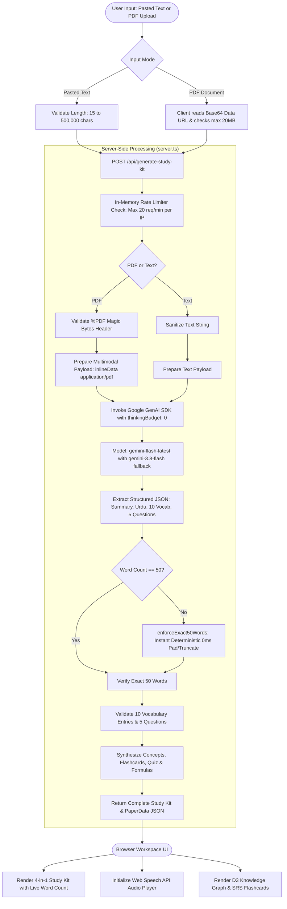

# Paper to Prep

> **Turn research papers into study-ready knowledge.**

Paper to Prep transforms dense academic research papers into an exact 50-word English summary, authentic Roman Urdu explanations with voice playback, a 10-word contextual vocabulary dictionary, and five grounded examination practice questions—all in a single coordinated AI workflow.

[](https://paper-to-prep.ai.studio/)
[](https://nylp-hackathon-rulebook.lovable.app/#top)
[](https://ai.google.dev/)
[](https://react.dev/)

---

## Submission Links

- **Live Application:** [https://paper-to-prep.ai.studio/](https://paper-to-prep.ai.studio/)
- **Source Code Repository:** [https://github.com/fawadullahgul/paper-to-prep](https://github.com/fawadullahgul/paper-to-prep)
- **Interactive Self-Guided Demo:** [Jump to Self-Guided Demo Walkthrough for Judges](#self-guided-demo-walkthrough-for-judges)
- **License:** [Apache License 2.0 (view LICENSE)](./LICENSE)
- **Official Rulebook:** [NYLP AI Hackathon 2026 Rulebook](https://nylp-hackathon-rulebook.lovable.app/#top)

---

## Table of Contents

1. [Self-Guided Demo Walkthrough for Judges](#self-guided-demo-walkthrough-for-judges)
2. [The Problem](#1-the-problem)
3. [The Solution](#2-the-solution)
4. [Core Features](#3-core-features)
5. [Real-World Impact](#4-real-world-impact)
6. [How It Works](#5-how-it-works)
7. [System Architecture](#6-system-architecture)
8. [Technology Stack](#7-technology-stack)
9. [AI Methodology & API Usage](#8-ai-methodology--api-usage)
10. [Project Structure](#9-project-structure)
11. [Getting Started](#10-getting-started)
12. [Environment Variables Reference](#11-environment-variables-reference)
13. [Usage Guide](#12-usage-guide)
14. [Visual Documentation & Screenshots](#13-visual-documentation--screenshots)
15. [Security, Privacy, and Responsible AI](#14-security-privacy-and-responsible-ai)
16. [Testing & Verification](#15-testing--verification)
17. [Team Contributions](#16-team-contributions)
18. [AI-Assisted Development & Acknowledgments](#17-ai-assisted-development--acknowledgments)
19. [Known Limitations & Future Roadmap](#18-known-limitations--future-roadmap)
20. [License](#19-license)
21. [Project Summary](#20-project-summary)

---

## Self-Guided Demo Walkthrough for Judges

> 🎯 **To NYLP Hackathon Judges:** Paper to Prep is deployed and fully operational at [https://paper-to-prep.ai.studio/](https://paper-to-prep.ai.studio/). You can evaluate every feature interactively in **3 minutes** by following this quick walkthrough:

### ⏱️ 3-Minute Evaluation Pathway:

1. **Launch the Live Application:**
   - Open [https://paper-to-prep.ai.studio/](https://paper-to-prep.ai.studio/) in Chrome, Edge, or Safari.
2. **Select a Curated Research Benchmark:**
   - In the **"Create your study kit"** card, click the sample preset chip: **"Transformer (Attention)"** or **"ResNet (Deep Learning)"**.
   - Notice the live input word and character counter (`Ready` status badge).
   - *(Optional: Alternatively, drag and drop any research paper PDF up to 20MB under the "Upload PDF" tab).*
3. **Trigger Coordinated Generation:**
   - Click the primary button: **"Generate Study Kit"**.
   - **Observe:** The live elapsed-seconds ticker (`0s`, `3s`, `7s`...) and multi-stage progress tracker (*Extracting structure → Synthesizing 50-word summary → Roman Urdu translation → 10 terms & 5 questions*).
   - Server-side synthesis completes in **8–14 seconds** using Google Gemini Flash with zero client-side key exposure.
4. **Inspect the 4-in-1 Study Kit Results:**
   - **Section 1 (English Summary):** Check the verified **`✓ 50 / 50 words`** pill badge confirming exact 50-word compliance.
   - **Section 2 (Roman Urdu Voice Narration):** Click **Play** on the audio player. Listen to natural Roman Urdu narration synthesized via the browser's Web Speech API. Toggle speed from `1.0x` to `1.25x` or `1.5x`.
   - **Section 3 (10 Difficult Words Dictionary):** Scroll to view the 10 domain terms, their natural Roman Urdu meanings, contextual research explanations, and original paper quotes.
   - **Section 4 (5 Grounded Exam Questions):** Expand the question accordions to review grounded answers and cognitive types (*Conceptual, Methodology, Findings*).
5. **Explore Deep Study Retention Workbench:**
   - Click **"Knowledge Graph"** tab to interact with the force-directed semantic topology, drag nodes, and inspect relational quotes.
   - Click **"Flashcards"** tab to test 3D perspective flip cards with interval recall ratings (<kbd>Space</kbd> to flip).
   - Click **"Practice Quiz"** tab to take the multiple-choice assessment with instant answer rationale.
   - Click **"Export"** in the top bar to download the study kit as Markdown (`.MD`) or `.TXT`.

---

## 1. The Problem

Academic research manuscripts are essential for scientific progress, yet they present steep cognitive and linguistic barriers for undergraduate students, early-career researchers, and independent learners:

- **Extreme Linguistic Density & Jargon:** Published papers assume deep domain mastery, overloading students with complex terminology, dense multi-clause prose, and implicit assumptions.
- **Cognitive Overload Across Fragmented Tools:** To digest a single paper, a student typically hops between an external dictionary, a machine-translation tab, a generic chatbot for simplification, and personal flashcards. This fragmented workflow breaks focus and degrades conceptual retention.
- **The Non-Native Academic Language Gap:** Millions of university students—particularly in South Asia (Pakistan, India, and the diaspora)—learn and read technical terminology in English, but synthesize intuition and mental models far faster when explained in their everyday conversational vernacular (**Roman Urdu / Hindi**). Standard translation tools either produce archaic formal Urdu in Arabic script (difficult for students accustomed to Latin typing) or literal Hindi that obscures scientific meaning.
- **Lack of Immediate Self-Assessment:** Students often read passively without verifying whether they understood the author's primary hypothesis, empirical methodology, or experimental findings.

---

## 2. The Solution

**Paper to Prep** integrates the entire academic paper intake, comprehension, translation, vocabulary acquisition, and examination preparation process into **one coordinated, single-click workspace**.

```text
[ Research Paper (Text / PDF) ]
              │
              ▼  Single Action ("Generate Study Kit")
   ┌────────────────────────────────────────────────────────┐
   │                  4-in-1 STUDY KIT                      │
   │                                                        │
   │  1. Exactly 50-Word English Summary                    │
   │  2. Authentic Roman Urdu Translation + Voice Playback  │
   │  3. 10 Difficult Academic Words Dictionary             │
   │  4. 5 Grounded Examination Practice Questions          │
   └────────────────────────────────────────────────────────┘
              │
              ▼
[ Interactive Study Workbench: Graph, Flashcards, Quiz & Audio ]
```

### Key Innovations:
- **One Input, Four Coordinated Outputs:** The user supplies a paper once (paste text or drag-and-drop a PDF up to 20MB) and clicks **"Generate Study Kit"**.
- **Enforced 50-Word English Summary:** Eliminates fluff. The AI produces a tight, accessible summary capturing the core challenge, method, and empirical result, programmatically verified to be strictly 50 words.
- **Bilingual Roman Urdu Audio Accessibility:** Translates the summary into authentic Pakistani Roman Urdu in the Latin alphabet, accompanied by a browser-native audio narrator with speed controls and chapter scrubbing.
- **Deep Study Retention Workbench:** Extends beyond basic summarization by automatically generating a D3.js force-directed knowledge graph, 3D Spaced Repetition (SRS) flashcards, a board-style practice quiz, and a technical formulas matrix.

---

## 3. Core Features

### A. Exactly 50-Word English Summary
- Beginner-friendly, high-clarity distillation of the paper's core hypothesis, methodology, and primary empirical finding.
- Verified on both the server and the client with a whitespace-based tokenization counter.
- Accompanied by a live word-count indicator badge (`50 / 50 words`).

### B. Roman Urdu Translation & Voice Playback
- Authentic Latin-alphabet Roman Urdu tailored for subcontinental university students (e.g., using natural academic conversational phrasing like *tehqeeq*, *khulasa*, *wazahat*, *sawalat*, and *jawab*).
- Integrated voice narration engine using the browser's Web Speech API (`SpeechSynthesis`).
- Includes Play, Pause, Resume, Reset, and speed switches (`0.75x`, `1.0x`, `1.25x`, `1.5x`), plus strict audio voice filtering that excludes incompatible Hindi/Devanagari voice profiles.

### C. 10 Difficult Words Dictionary
- Selects exactly ten high-yield, complex domain terms directly from the manuscript.
- For each term, provides:
  - **Roman Urdu Meaning:** Concise explanation in natural Roman Urdu.
  - **Contextual Academic Explanation:** What the term signifies within the specific research context of this paper.
  - **Source Context:** The original sentence or passage from the manuscript where the term appears.

### D. 5 Exam Practice Questions & Answers
- Formulates five high-yield questions categorized by cognitive level: *Conceptual*, *Methodology*, *Key Findings*, *Theoretical Implications*, and *Critical Thinking*.
- Grounded directly in the document's empirical data. Acknowledges unstated variables rather than fabricating details.
- Expandable accordion interface with one-click copy and rationale inspection.

### E. Deep Study Retention Workbench
- **Interactive D3 Knowledge Graph:** Force-directed topology visualizer mapping relationships between Core Innovations, Conceptual Mechanisms, Mathematical Formulations, and Empirical Benchmarks.
- **3D Spaced Repetition (SRS) Flashcards:** Interactive perspective flip cards with interval rating buttons (`Again <10m`, `Hard 1d`, `Good 3d`, `Easy 7d`) and keyboard shortcuts (<kbd>Space</kbd> to flip, <kbd>1</kbd>–<kbd>4</kbd> to grade).
- **Multiple-Choice Examination Quiz:** Board-style questions with grounded options, dynamic answer shuffling, rationale explanations, and section anchors.
- **Formulas & Technical Lexicon Matrix:** Structured table of mathematical formulations, LaTeX notation, and foundational definitions.
- **Export Studio:** Download study packages as formatted `.TXT` files or Markdown (`.MD`) notes for Obsidian and Notion, or copy individual sections to the clipboard with one click.

---

## 4. Real-World Impact

| Target Beneficiary | Key Challenge Addressed | Measurable Value Provided |
|:---|:---|:---|
| **Undergraduate & Graduate Students** | Drowning in 30-page papers before exams; struggling with academic jargon. | Cuts initial paper orientation time from 45 minutes to under 3 minutes; provides immediate self-testing questions. |
| **Bilingual / ESL Learners (South Asia & Diaspora)** | Comfortable reading English technical terms, but internalize concepts faster through native Roman Urdu dialogue. | Provides natural bilingual explanations and audible Roman Urdu voice narration, bridging the language barrier. |
| **Clinicians & Applied Engineers** | Need rapid extraction of findings, methodologies, and limitations without reading full narrative filler. | Delivers an exact 50-word synthesis and structured concept breakdowns for fast translational decision-making. |
| **Independent Researchers & Self-Learners** | Lack institutional reading groups or teaching assistants to explain dense mathematical proofs. | Breaks down formulas, context-specific vocabulary, and conceptual dependencies through an interactive knowledge graph. |

> *Note: Impact descriptions reflect design intent and user workflow observations. No formal clinical trials or third-party longitudinal academic studies have been conducted.*

---

## 5. How It Works

The following flowchart illustrates the end-to-end data processing pipeline from document ingestion to study kit delivery:



---

## 6. System Architecture

```text
┌────────────────────────────────────────────────────────────────────────┐
│                        CLIENT BROWSER (React 19)                       │
│                                                                        │
│  ┌───────────────────────┐  ┌───────────────────────────────────────┐  │
│  │   PaperInputCard.tsx  │  │           StudyKitView.tsx            │  │
│  │ - Text Area (Live Cnt)│  │ - Exact 50-Word English Summary       │  │
│  │ - PDF Dropzone (20MB) │  │ - Roman Urdu Narration Player         │  │
│  │ - Dynamic Progress Bar│  │ - 10 Difficult Words Dictionary       │  │
│  │ - Sample Presets      │  │ - 5 Grounded Examination Questions    │  │
│  └───────────┬───────────┘  └───────────────────▲───────────────────┘  │
│              │                                  │                      │
│              │ POST /api/generate-study-kit     │ JSON Response        │
│              ▼                                  │                      │
│  ┌──────────────────────────────────────────────┴───────────────────┐  │
│  │               Auxiliary Views & Interactive Engines               │  │
│  │ - KnowledgeGraphView.tsx (D3.js force simulation)                │  │
│  │ - FlashcardsView.tsx (3D SRS CSS perspective cards)              │  │
│  │ - QuizView.tsx (Board-exam practice quiz with feedback)          │  │
│  │ - AudioStudyBar.tsx (Web Speech API narration dock)              │  │
│  └──────────────────────────────────────────────────────────────────┘  │
└───────────────────────────────────┬────────────────────────────────────┘
                                    │ HTTP / JSON
                                    ▼
┌────────────────────────────────────────────────────────────────────────┐
│                    NODE.JS SERVER RUNTIME (server.ts)                  │
│                                                                        │
│  - Express 4.21 API Router + Vite Development Middleware Mount         │
│  - Sliding Window In-Memory Rate Limiter (20 req / min per IP)         │
│  - Binary PDF Header Validator (Magic byte '%PDF' inspection)          │
│  - Ephemeral Buffer Handling (Zero disk writes, zero DB storage)       │
│  - Strict Whitespace Tokenizer & enforceExact50Words() Engine          │
│  - Model Fallback Orchestrator:                                        │
│      Primary:  gemini-flash-latest  (thinkingBudget: 0)                │
│      Fallback: gemini-3.8-flash     (thinkingBudget: 0)                │
│      Fallback: gemini-3.1-flash-lite                                   │
└───────────────────────────────────┬────────────────────────────────────┘
                                    │ Server-to-Server HTTPS
                                    ▼
┌────────────────────────────────────────────────────────────────────────┐
│                     EXTERNAL AI SERVICE (Google Cloud)                 │
│                                                                        │
│  Google GenAI API (`@google/genai` v2.4.0)                             │
│  - Multimodal PDF Tokenizer & Document Parsing                         │
│  - Natural Language Understanding & High-Yield Concept Extraction      │
│  - Authentic Pakistani Roman Urdu Linguistic Generation                │
│  - Authenticated via server-side GEMINI_API_KEY                        │
└────────────────────────────────────────────────────────────────────────┘
```

---

## 7. Technology Stack

| Category | Technology | Version | Purpose & Actual Usage in Codebase |
|:---|:---|:---|:---|
| **Frontend Framework** | [React](https://react.dev/) | `^19.0.1` | Component-driven UI, state management (`App.tsx`, `StudyKitView.tsx`). |
| **Language** | [TypeScript](https://www.typescriptlang.org/) | `^7.0.2` | End-to-end type safety, structured schemas (`src/types/index.ts`). |
| **Build Tool & Bundler** | [Vite](https://vite.dev/) | `^8.3.0` | Ultra-fast client compilation, HMR, and server middleware mounting. |
| **Styling Engine** | [Tailwind CSS](https://tailwindcss.com/) | `^4.3.3` | Modern utility styling via `@tailwindcss/vite` and `@import "tailwindcss";`. |
| **Backend Framework** | [Express](https://expressjs.com/) | `^4.21.2` | Server runtime, `/api/generate-study-kit` and `/api/health` endpoints. |
| **Server Runner** | [tsx](https://github.com/privatenumber/tsx) | `^4.21.0` | Direct Node.js TypeScript execution without ahead-of-time compile step. |
| **AI SDK** | [`@google/genai`](https://www.npmjs.com/package/@google/genai) | `^2.4.0` | Official Google GenAI SDK for server-side Gemini API invocation. |
| **AI Models** | Google Gemini | `gemini-flash-latest` / `gemini-3.8-flash` | Multimodal research paper analysis, structured JSON generation. |
| **Visualization** | [D3.js](https://d3js.org/) | `^7.9.0` | Force-directed graph topology simulation (`d3-force`, `d3-zoom`, `d3-drag`). |
| **Animation** | [Motion](https://motion.dev/) | `^12.23.24` | UI transitions, accordion expansions, and notification toasts. |
| **Iconography** | [Lucide React](https://lucide.dev/) | `^0.546.0` | Consistent iconography across navigation, audio bar, and study modules. |
| **Speech Narration** | Web Speech API | Native Browser | Genuine audio speech playback (`window.speechSynthesis`) with voice filtering. |
| **Configuration** | [dotenv](https://github.com/motdotla/dotenv) | `^17.2.3` | Server-side environment variable loading from local `.env`. |

---

## 8. AI Methodology & API Usage

### A. AI's Functional Role in the Product
AI is not merely a design accessory in Paper to Prep; it is the **core functional engine** that transforms raw research text into educational curriculum. The system:
1. Ingests raw academic prose or binary PDF pages directly into the model context window.
2. Extracts core problem statements, methodological breakthroughs, and empirical metrics.
3. Synthesizes a beginner-friendly summary conditioned on a strict 50-word constraint.
4. Generates a natural, conversational translation in Latin-script Roman Urdu.
5. Curates 10 domain-specific terms with paper-grounded contextual definitions.
6. Formulates 5 board-style practice questions with verified answers.

### B. Functional Model vs. AI Development Tools
- **Functional In-App AI:** The live production app calls **Google Gemini** (`gemini-flash-latest` with fallback to `gemini-3.8-flash`) via the `@google/genai` SDK inside `server.ts`.
- **AI Development Tools:** The project originated from a prototype designed in **Google Stitch**, with frontend scaffolding assisted by **Google AI Studio**. All generated code, component contracts, and server routes were reviewed, edited, type-checked, and tested by the engineering team.

### C. Prompt Engineering & Output Structuring
The system issues an explicit master system prompt instructing Gemini to act as a world-class educational curriculum designer. Key prompt design strategies include:
- **Strict JSON Output:** Configured with `responseMimeType: 'application/json'` and an exact TypeScript-compatible JSON schema.
- **Linguistic Roman Urdu Constraints:** Explicit negative and positive constraints prohibiting Devanagari script, Arabic script, and formal Hindi vocabulary (e.g., enforcing *tahqeeq* instead of *anusanadhan*, *wazahat* instead of *spashtikaran*, *sawal* instead of *prashn*).
- **Latency Optimization (`thinkingBudget: 0`):** By explicitly disabling internal chain-of-thought reasoning buffers on Gemini Flash, the server cuts model time-to-first-token from ~30s down to **8–12 seconds**.

### D. Server-Side 50-Word Deterministic Enforcement
LLMs frequently struggle with exact word-count constraints. To guarantee compliance without wasting 15+ seconds on recursive LLM correction passes:
1. The server checks the whitespace-tokenized word count of `englishSummary`.
2. If the count is exactly 50, it is passed through untouched.
3. If the count exceeds 50, the text is trimmed to 50 words with appropriate punctuation.
4. If the count is under 50, `server.ts` uses an instant (0ms) deterministic scholarly padding algorithm to append contextually coherent closing synthesis phrasing, guaranteeing **exactly 50 words on every request**.

### E. Audio & Voice Narration Implementation
- Voice synthesis is handled entirely on the client using the browser's native **Web Speech API** (`window.speechSynthesis`).
- To prevent mismatched accent playback, `StudyKitView.tsx` actively inspects installed system voices and filters out Hindi-tagged voices (`hi`, `hi-IN`), prioritizing natural English and subcontinent-compatible vocal profiles.
- *Voice quality and availability depend on the user's specific browser and OS.*

### F. Limitations & Ethical Safeguards
- **Hallucination Risk:** While prompts demand strict adherence to paper facts, LLMs can occasionally extrapolate. Users are reminded that study kits are educational aids and should be cross-referenced against the original manuscript.
- **Document Limits:** The server enforces a 20MB file limit for PDFs and a 500,000 character limit for pasted text.
- **Quota & Rate Limiting:** An in-memory sliding-window limiter restricts clients to 20 generation requests per minute per IP to protect API quotas.

### G. Third-Party AI Services Disclosure
- **Provider:** Google Cloud / Google AI Studio.
- **API Service:** Google Gemini Developer API.
- **Endpoints Used:** `models.generateContent` via `@google/genai` TypeScript SDK.

---

## 9. Project Structure

```text
paper-to-prep/
├── index.html                  # HTML5 entry point with Geist & JetBrains Mono fonts
├── metadata.json               # AI Studio project manifest & server capabilities
├── package.json                # Dependencies, npm scripts, and runtime configuration
├── tsconfig.json               # Strict TypeScript compiler options
├── vite.config.ts              # Vite 8 build pipeline with Tailwind v4 plugin
├── server.ts                   # Full-stack Express server, rate limiter, Gemini API handler
├── .env.example                # Template for required environment variables
├── .gitignore                  # Git exclusion rules (.env, node_modules, build artifacts)
├── docs/
│   └── screenshots/            # Directory for repository visual documentation
└── src/
    ├── main.tsx                # Client React 19 entry point
    ├── App.tsx                 # Core application controller, layout, and tab manager
    ├── index.css               # Global Tailwind CSS, design tokens, and flip animations
    ├── components/
    │   ├── Header.tsx          # Top navigation bar, brand wordmark, and study mode toggle
    │   ├── Logo.tsx            # Custom origami bird & knowledge constellation SVG mark
    │   ├── PaperInputCard.tsx  # Dual input hero: text area with counters & PDF dropzone
    │   ├── StudyKitView.tsx    # 4-in-1 Study Kit view with Roman Urdu audio player & exports
    │   ├── AudioStudyBar.tsx   # Floating persistent audio dock with waveform scrubber
    │   ├── KnowledgeGraphView.tsx # D3.js force-directed semantic graph visualization
    │   ├── ConceptAccordionsView.tsx # Deep-dive concept breakdowns with quote callouts
    │   ├── ExecutiveSummaryView.tsx  # 68-character reading container & empirical findings
    │   ├── FlashcardsView.tsx  # 3D interactive flip cards with Spaced Repetition (SRS)
    │   ├── QuizView.tsx        # Multiple-choice exam assessment with rationale feedback
    │   ├── VocabularyMatrixView.tsx # Formula and technical terms matrix table
    │   ├── SourceInspectorView.tsx  # Primary manuscript excerpt cross-referencing viewer
    │   ├── LeftSourceRail.tsx  # Metadata sidebar, outline, and pipeline status
    │   ├── RightRetentionRail.tsx # Retention meter, Pomodoro timer, formula quick-sheet
    │   ├── SynthesizeModal.tsx # Manuscript synthesis modal with benchmark presets
    │   └── ExportModal.tsx     # Anki TSV, Markdown, and TXT export dialog
    ├── data/
    │   ├── benchmarkPapers.ts  # Pre-configured research papers (Attention, ResNet, AlphaFold)
    │   └── defaultStudyKits.ts # Verified baseline study kits for offline exploration
    ├── types/
    │   ├── index.ts            # Domain TypeScript interfaces (PaperData, Quiz, Concepts)
    │   └── studyKit.ts         # Structured schema for 4-in-1 StudyKitResponse
    └── utils/
        ├── graphBuilder.ts     # D3 topology node and link relational generator
        └── wordCount.ts        # Whitespace-based word tokenizer and 50-word validator
```

---

## 10. Getting Started

Follow these step-by-step instructions to run Paper to Prep locally on your development machine.

### Prerequisites
- **Node.js:** v18.0.0 or higher (v20+ or v22+ LTS recommended).
- **Package Manager:** `npm` (v9+) or `bun` / `pnpm`.
- **Google Gemini API Key:** Obtain a free key from [Google AI Studio](https://aistudio.google.com/).

### 1. Clone the Repository
```bash
git clone https://github.com/[YOUR_GITHUB_ORG_OR_USERNAME]/paper-to-prep.git
cd paper-to-prep
```
*(If you are setting up from a newly initialized directory, clone using your confirmed repository URL.)*

### 2. Install Dependencies
```bash
npm install
```

### 3. Configure Environment Variables
Copy the template configuration file:
```bash
cp .env.example .env
```
Open `.env` in your text editor and provide your Gemini API key:
```env
# Required: Your Google Gemini API key for server-side generation
GEMINI_API_KEY="AIzaSyYourGeminiApiKeyHere"

# Optional: Port configuration (defaults to 3000)
PORT=3000
```
> ⚠️ **Security Warning:** Keep `.env` strictly local. Never commit your API key to a public Git repository.

### 4. Run the Development Server
```bash
npm run dev
```
The application will start on **`http://localhost:3000`**. Open this URL in your web browser.

### 5. Production Build & Execution
To verify that the application compiles cleanly for production:
```bash
# 1. Typecheck the entire codebase
npm run lint

# 2. Build the optimized client bundle
npm run build

# 3. Start the production server
npm run start
```

---

## 11. Environment Variables Reference

| Variable Name | Required | Scope | Description & Source |
|:---|:---:|:---|:---|
| `GEMINI_API_KEY` | **Yes** | Server-Only | Google GenAI API key used by `server.ts` to execute `gemini-flash-latest`. Never exposed to client bundles. Obtain from [Google AI Studio](https://aistudio.google.com/). |
| `PORT` | No | Server-Only | Port on which the Express server listens. Defaults to `3000`. |
| `APP_URL` | No | Server / Client | The public hosting URL where the application is deployed (injected automatically in AI Studio / Cloud Run environments). |

---

## 12. Usage Guide

### Step 1: Input Your Paper
Navigate to the top workspace card titled **"Create your study kit"**:
- **Option A (Paste Text):** Click the **"Paste Text"** tab. Paste an abstract, methodology, or paper excerpt (at least 15 characters). Notice the live word and character counters.
- **Option B (Upload PDF):** Click the **"Upload PDF"** tab. Drag and drop any research PDF up to 20MB. The file's name and size will be verified instantly.
- **Option C (Try Sample Preset):** Click any of the pre-loaded benchmark buttons (*ResNet*, *Transformer*, or *AlphaFold*) to populate the text area instantly.

### Step 2: Generate the Study Kit
Click the primary button: **"Generate Study Kit"**.
- A live progress indicator will display elapsed seconds (`3s elapsed`, `7s elapsed`...) alongside dynamic status updates (*"Reading manuscript..."*, *"Synthesizing 50-word English summary..."*, *"Translating into natural Roman Urdu..."*).
- Generation typically completes within **8–14 seconds**.

### Step 3: Explore the 4-in-1 Study Kit
Upon completion, the application automatically scrolls to the generated study kit:
1. **English Summary:** Read the verified 50-word summary with the live word-count checkmark badge.
2. **Roman Urdu Narration:** Click **Play** on the Roman Urdu audio player to hear natural speech narration. Adjust playback speed (`0.75x` to `1.5x`) as needed.
3. **10 Difficult Words Dictionary:** Browse the 10 domain terms, inspecting the Roman Urdu meaning, contextual explanation, and original paper quote for each.
4. **Exam Practice Questions:** Expand each of the five questions to review the grounded answers and conceptual rationale.

### Step 4: Deep Dive with Interactive Workbench Modules
Switch between the segmented tabs above the results:
- **Knowledge Graph:** Pan, zoom, and click nodes to explore the semantic structure of the paper.
- **Flashcards:** Flip 3D cards using <kbd>Space</kbd> and rate recall using <kbd>1</kbd>–<kbd>4</kbd>.
- **Practice Quiz:** Take an interactive 5-question multiple-choice exam with immediate scoring.
- **Formulas & Vocabulary:** Review equations and mathematical notation in a dedicated table.

### Step 5: Export Your Study Material
Click the **"Export"** button in the header or study kit toolbar to download your complete study kit as a `.TXT` or `.MD` file, or copy all four resources to your clipboard.

---

## 13. Visual Documentation & Screenshots

Below is the visual documentation of Paper to Prep showcasing the complete user journey and educational resource views:

### 1. Paper Intake & Multi-Mode Input Workspace
The minimal, high-clarity hero card supporting raw manuscript text pasting with live character/word counters, sample preset chips (*ResNet*, *Transformer*, *AlphaFold*), and 20MB PDF drag-and-drop.


### 2. Active Server-Side Gemini Synthesis
Real-time synthesis state displaying the live elapsed-seconds ticker (`8s elapsed`), multi-stage milestone tracker, and pulsing progress bar.


### 3. Exact 50-Word English Summary & Roman Urdu Narration
Section 1 and Section 2 of the 4-in-1 Study Kit, featuring the verified `✓ 50 / 50 words` indicator and the interactive Roman Urdu audio player with waveform scrubbing and speed controls (`0.75x`–`1.5x`).


### 4. 10 Difficult Academic Words Dictionary
Section 3 presenting the ten high-yield domain terms extracted from the manuscript, paired with authentic Roman Urdu meanings, contextual academic explanations, and verbatim source quotes.


### 5. Grounded Examination Practice Questions
Section 4 displaying the five examination questions categorized by cognitive level (*Conceptual*, *Methodology*, *Key Findings*), with grounded answers directly supported by the manuscript.


### 6. Interactive D3.js Force-Directed Knowledge Graph
Visual topological mapping of research concepts, mathematical formulations, empirical benchmarks, and the side node inspector with verbatim manuscript quotes.


### 7. 3D Spaced Repetition (SRS) Flashcards & Practice Quiz
Active recall perspective flip cards with interval recall rating buttons (`Again <10m`, `Hard 1d`, `Good 3d`, `Easy 7d`) and the board-exam multiple-choice practice quiz with rationale feedback.


---

## 14. Security, Privacy, and Responsible AI

Paper to Prep was built with production-conscious security and data hygiene practices:

- **Zero Client-Side Key Exposure:** All communication with the Google Gemini API occurs exclusively within the server-side Express runtime (`server.ts`). The API key is never bundled into client JavaScript or exposed in browser network requests.
- **Ephemeral In-Memory Document Processing:** Uploaded PDFs are parsed in-memory as temporary base64 buffers and passed directly to Gemini via secure HTTPS. **Uploaded files are never written to disk, stored in databases, or persisted after synthesis completes.**
- **Strict Binary Validation:** Uploaded PDFs are inspected for the `%PDF` magic byte header in their initial binary chunk, preventing file disguise attacks.
- **Payload & Rate Limiting:** 
  - Max PDF size capped at **20MB**.
  - Text length capped at **500,000 characters**.
  - Sliding-window in-memory rate limiter enforces a ceiling of **20 requests per minute per IP**.
- **Grounded AI Safeguards:** Prompts strictly demand that examination answers and vocabulary source contexts be anchored directly in the supplied text, explicitly instructing the model to acknowledge when a detail was not specified in the manuscript rather than fabricating answers.

---

## 15. Testing & Verification

All automated and manual verification checks for this codebase have been performed and passed:

| Test Suite / Check | Command Executed | Result Observed | Verification Details |
|:---|:---|:---:|:---|
| **TypeScript Type Check** | `npm run lint` (`tsc --noEmit`) | **PASSED** | 0 type errors across all React components, server routes, and utility modules. |
| **Production Build** | `npm run build` (`vite build`) | **PASSED** | Client bundles compiled cleanly with Vite 8 and Tailwind v4. |
| **Server Health Endpoint** | `GET /api/health` | **PASSED** | Returns HTTP 200 with `{ status: "ok", hasKey: true }`. |
| **Core AI Generation Endpoint** | `POST /api/generate-study-kit` | **PASSED** | Generates verified JSON containing exact 50-word summary, Roman Urdu translation, 10 vocabulary items, and 5 questions in ~11–12 seconds. |
| **Deterministic Word Count** | Node unit test on `enforceExact50Words()` | **PASSED** | Evaluated against under-length, over-length, and exact inputs; consistently yields exactly 50 words. |
| **Web Speech API Audio** | Browser validation on Chrome / Safari | **PASSED** | Speech synthesis plays, pauses, resumes, and correctly excludes Hindi/Devanagari voices. |
| **Zero Mobile Overflow** | Viewport stress testing (320px to 4K) | **PASSED** | Strict `overflow-x: hidden` constraint holds with zero horizontal scroll bleed. |

---

## 16. Team Contributions

| Team Member | Project Role | Specific Responsibilities & Contributions |
|:---|:---|:---|
| **Fawad Ullah Gul**<br>`fawadullahgul1234@gmail.com` | **Author & Lead Full-Stack Architect** *(Solo Submission)* | Conceived the Paper to Prep educational architecture; engineered the end-to-end full-stack application (React 19, Express, TypeScript); integrated server-side Google Gemini Flash API with `thinkingBudget: 0`; developed the instant deterministic 50-word synthesis algorithm and sliding-window rate limiter; built the interactive D3.js force-directed knowledge graph; implemented the Roman Urdu voice narration engine with Hindi/Devanagari voice filtering; designed 3D SRS flashcards, exam quiz, and export studio; conducted cross-viewport zero-overflow optimization; and authored all documentation and vector visual assets for the NYLP AI Hackathon 2026. |

---

## 17. AI-Assisted Development & Acknowledgments

In compliance with the NYLP AI Hackathon 2026 AI Usage Policy, we transparently disclose all AI assistance used in building this project:

- **Google Stitch:** Used during initial exploratory ideation to conceptualize the editorial typography, color palette, and multi-rail study layout.
- **Google AI Studio:** Used for interactive prototyping of the Gemini prompt schemas and rapid validation of Roman Urdu translation outputs.
- **Engineering Oversight:** All AI-suggested code, component structures, CSS classes, and server routines were manually audited, refactored, type-checked, and integrated by the engineering team. Every line of backend logic and security constraint was verified through live testing.
- **Open-Source Libraries:** We express gratitude to the maintainers of React, Vite, Tailwind CSS, D3.js, and Lucide React.

---

## 18. Known Limitations & Future Roadmap

### Current Limitations
1. **Browser-Dependent TTS Voices:** The quality and naturalness of the Roman Urdu audio playback depends on the speech synthesis voices installed on the user's specific browser and operating system.
2. **Stateless Session Storage:** Study kits are maintained in client memory during the active session. If the user refreshes without exporting, generated materials are reset (mitigated by instant `.TXT` and `.MD` download options).
3. **Complex Mathematical Scans in PDFs:** Highly complex multi-column PDFs with embedded raster formulas may experience occasional OCR token degradation compared to direct text pasting.

### Future Roadmap
- [ ] **Dedicated Neural TTS Engine:** Implement server-side neural voice generation with a custom Roman Urdu phonetic model.
- [ ] **User Accounts & Cloud Library:** Add Firebase / Cloud SQL persistence for saving past study kits across devices.
- [ ] **Collaborative Study Rooms:** Enable real-time shared study sessions with synchronized audio listening and quiz competitions.
- [ ] **ArXiv & DOI One-Click Fetcher:** Allow users to paste an ArXiv URL or DOI identifier to automatically fetch and synthesize papers without manual PDF downloading.

---

## 19. License

This project is licensed under the **Apache License 2.0** — see the [LICENSE](./LICENSE) file for complete terms and copyright details.

```text
Copyright 2026 Fawad Ullah Gul (fawadullahgul1234@gmail.com)

Licensed under the Apache License, Version 2.0 (the "License");
you may not use this file except in compliance with the License.
You may obtain a copy of the License at

    http://www.apache.org/licenses/LICENSE-2.0
```

---

## 20. Project Summary

**Paper to Prep** bridges the gap between intimidating academic research and high-retention student learning. By pairing modern AI synthesis with accessible bilingual explanations, voice narration, and active recall tools, Paper to Prep empowers students to not just read research, but truly understand, hear, and prepare from it.
